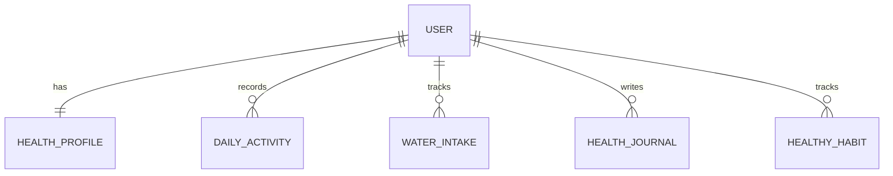

# HealthHub — ER Diagram

## 1. User
- user_id (PK)
- full_name
- email
- password_hash
- created_at

## 2. HealthProfile
- profile_id (PK)
- user_id (FK)
- date_of_birth
- height
- weight

## 3. DailyActivity
- activity_id (PK)
- user_id (FK)
- activity_type
- duration_minutes
- activity_date

## 4. WaterIntake
- water_id (PK)
- user_id (FK)
- amount_ml
- intake_date

## 5. HealthJournal
- journal_id (PK)
- user_id (FK)
- entry_text
- entry_date

## 6. HealthyHabit
- habit_id (PK)
- user_id (FK)
- habit_name
- completed
- habit_date

## Relationships

- One User has one HealthProfile.
- One User can have many DailyActivity records.
- One User can have many WaterIntake records.
- One User can have many HealthJournal entries.
- One User can have many HealthyHabit records.

## ER Diagram

